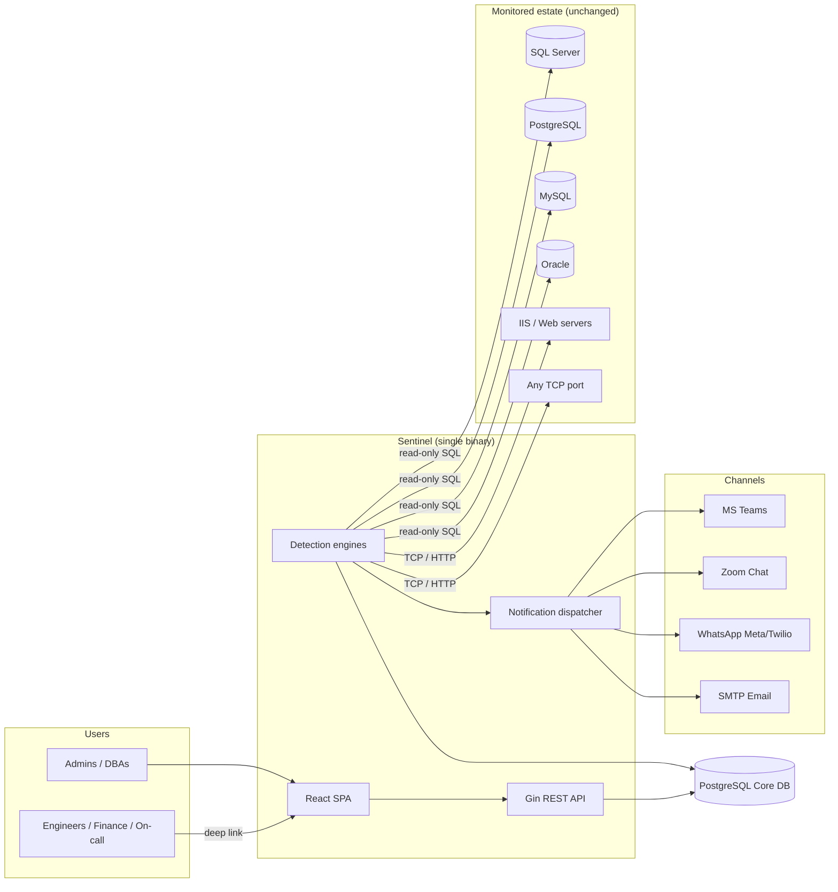
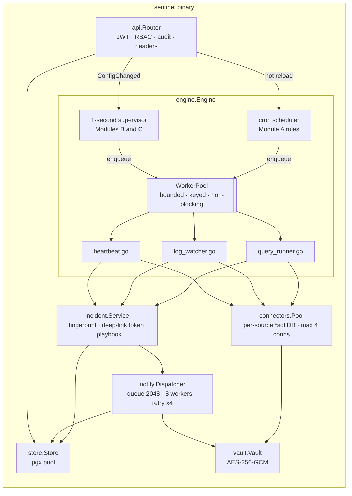
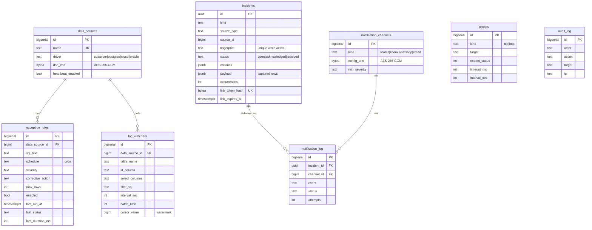
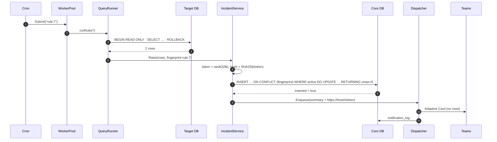
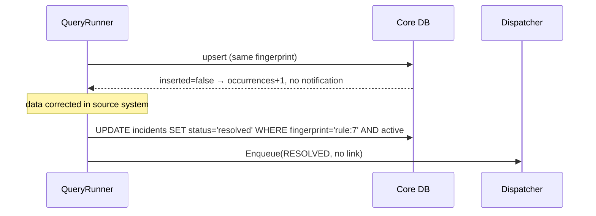

# Sentinel — Technical Design Document

**Zero-Trust Operational Exception & Observability Platform**
Version 1.0 · October 2026 · Audience: architects, developers, DBAs, security reviewers, operations

---

## Contents

1. [Purpose and scope](#1-purpose-and-scope)
2. [Design principles](#2-design-principles)
3. [Technology choices](#3-technology-choices)
4. [System architecture](#4-system-architecture)
5. [Component reference](#5-component-reference)
6. [Data model](#6-data-model)
7. [Runtime flows](#7-runtime-flows)
8. [Concurrency and performance model](#8-concurrency-and-performance-model)
9. [Security architecture](#9-security-architecture)
10. [REST API reference](#10-rest-api-reference)
11. [Notification payload specifications](#11-notification-payload-specifications)
12. [Configuration reference](#12-configuration-reference)
13. [Deployment](#13-deployment)
14. [Operations](#14-operations)
15. [Testing strategy](#15-testing-strategy)
16. [Extending the platform](#16-extending-the-platform)
17. [Known limitations and roadmap](#17-known-limitations-and-roadmap)

---

## 1. Purpose and scope

Sentinel detects three classes of operational problems in existing enterprise systems and routes them to people, **without any integration code in the monitored applications**:

| Module | Detects | Mechanism |
|---|---|---|
| **A — Business Data Exception Engine** | Data conditions that violate business rules | Scheduled read-only SQL; `rows > 0` ⇒ exception |
| **B — Runtime Application Exception Watcher** | New application errors | Incremental polling of the application's own log table |
| **C — Infrastructure & DB Outage Monitor** | Unreachable databases, servers, IIS sites, ports | `SELECT 1` heartbeat; TCP handshake; HTTP status probe |

Out of scope for v1: metrics/time-series (CPU, memory), distributed tracing, log full-text indexing, ticketing integration.

---

## 2. Design principles

| Principle | Realisation |
|---|---|
| **Plug-and-play / decoupled** | No agent or SDK. Only a read-only DB login and network reachability. Removing Sentinel leaves no trace in target systems. |
| **Zero trust** | Every API request authenticated (JWT) and authorised (role); deep links are capability tokens that *also* require authentication; secrets encrypted at rest; no data in notifications. |
| **Low latency, low footprint** | Single static Go binary (~34 MB), bounded worker pool, pooled connections, code-split SPA. Measured p95 API latency ≈ 2–4 ms (§8.4). |
| **Never block** | Schedulers only *enqueue*; all I/O runs in workers; notification delivery is asynchronous with its own queue. |
| **Be a polite guest** | Max 4 connections per monitored DB, read-only transactions always rolled back, query timeout, `NOLOCK` on SQL Server log polling, row caps. |
| **No alert storms** | One active incident per fingerprint (DB-enforced), notify on open and on resolve only, consecutive-failure threshold for probes. |
| **Self-healing incidents** | Every detector also detects recovery and auto-resolves. |

---

## 3. Technology choices

| Layer | Choice | Rationale |
|---|---|---|
| Backend language | **Go 1.24** | Goroutines for cheap concurrency, native static binary, ~10 MB RSS idle, fast GC, first-class `database/sql`. |
| HTTP framework | **Gin 1.10** | Fastest mainstream Go router (radix tree), mature middleware model. |
| Scheduler | **robfig/cron v3** | Standard cron + seconds + descriptors (`@every 30s`), per-entry add/remove for hot reload. |
| Core DB | **PostgreSQL 14+** via **pgx v5** pool | JSONB for captured rows, partial unique indexes for de-duplication, `xmax` upsert detection. |
| Monitored DB drivers | `microsoft/go-mssqldb`, `jackc/pgx/stdlib`, `go-sql-driver/mysql`, `sijms/go-ora` (pure Go) | All pure Go → `CGO_ENABLED=0`, distroless image, no Oracle Instant Client needed. |
| Auth | JWT (HS256) via `golang-jwt/jwt/v5` | Drop-in replaceable by IdP JWKS (Entra ID, Okta, Keycloak). |
| Crypto | AES-256-GCM (Go stdlib) | Authenticated encryption for DSNs and channel secrets. |
| Frontend | **React 19 + Vite 6 + TypeScript + Tailwind CSS 4** | Fast HMR in dev, route-level code splitting: the deep-link page is a 2.4 KB (gzip) chunk on top of a ~100 KB shared framework bundle. |
| Testing | Go `testing` (+race), **Playwright** (API + UI + mobile), **k6** (load), GitHub Actions | See §15. |

---

## 4. System architecture

### 4.1 Context



### 4.2 Internal components



### 4.3 Source layout

```
backend/
  cmd/server/main.go          process wiring, graceful shutdown (SIGTERM, 20 s drain)
  cmd/token/main.go           token minting utility
  migrations/                 embedded, idempotent schema
  internal/config             env configuration
  internal/vault              AES-256-GCM
  internal/store              repository (only package that issues Core-DB SQL)
  internal/connectors         external DB pool, dialect SQL builder, row→JSON
  internal/engine             worker pool, cron, supervisor, modules A/B/C
  internal/incident           incident service, link tokens, playbooks
  internal/notify             dispatcher + Teams/Zoom/WhatsApp/Email adapters
  internal/api                router, handlers, middleware
frontend/src
  App.tsx                     routes (lazy), auth gate, /i/:token
  pages/*                     Dashboard, IncidentPage, config pages, Login
  components/*                DataGrid, ScheduleBuilder, CrudPage, Layout, Badges
demo/                         demo ERP DB, seeder, simulators, mock webhook
tests/e2e                     Playwright suite
tests/load                    k6 scenarios
```

---

## 5. Component reference

### 5.1 `engine.WorkerPool`

- Fixed goroutine count (`WORKER_POOL_SIZE`, default 32) consuming a buffered channel (`WORKER_QUEUE_SIZE`, default 1024).
- **Keyed in-flight guard** (`sync.Map`): `Submit("rule:17", fn)` is rejected while `rule:17` is queued or running. A slow query can never overlap with its next tick.
- **Non-blocking `Submit`**: if the queue is full the job is skipped and logged; the scheduler thread is never blocked.
- **Panic isolation**: each job runs under `recover()`; a panicking job never kills a worker.

### 5.2 Scheduling

| Driver | Used for | Behaviour |
|---|---|---|
| `robfig/cron` | Module A rules | Each enabled rule is a cron entry calling `TriggerRule(id)` → `pool.Submit`. CRUD calls `ScheduleRule` / `UnscheduleRule` (hot reload, no restart). Timezone UTC. |
| 1 s supervisor ticker | Modules B and C | Keeps `nextDue[key]` per watcher / data source / probe. Reloads definitions every 5 s or immediately after `ConfigChanged()`. |

### 5.3 Module A — `runRule`

1. Load rule and data source (fresh from Core DB — edits apply instantly).
2. Get pooled `*sql.DB` (decrypting DSN on first use).
3. `BeginTx(ReadOnly)`; fall back to a normal tx if the driver rejects read-only (SQL Server); **always `Rollback`**.
4. `ScanRows` with `max_rows` cap → `Result{Columns, Rows, Truncated}`; values normalised (bytes→UTF-8 or base64, time→RFC3339 UTC, big ints→string).
5. `rows == 0` → `incident.Resolve("rule:<id>")`; `rows > 0` → `incident.Raise(...)`.
6. `MarkRuleRun(status, duration)` — always, via `defer`.

### 5.4 Module B — `runWatcher`

- First run (`cursor_value = -1`): reads `MAX(id)` and stores it → no historical replay.
- Subsequent runs: dialect-specific incremental query, the watermark always a **bound parameter**:

| Driver | Generated SQL |
|---|---|
| SQL Server | `SELECT TOP (n) id, cols FROM t WITH (NOLOCK) WHERE id > @p1 [AND (filter)] ORDER BY id` |
| PostgreSQL | `SELECT id, cols FROM t WHERE id > $1 [AND (filter)] ORDER BY id LIMIT n` |
| MySQL | `… WHERE id > ? … LIMIT n` |
| Oracle | `… WHERE id > :1 … FETCH FIRST n ROWS ONLY` |

- Identifiers are validated against `^[A-Za-z_\[\]"\`][A-Za-z0-9_.\[\]"\`$#]*$`; `filter_sql` may not contain `;` or `--`; filter is admin-only.
- One incident per batch, fingerprint `watch:<id>:<maxId>`; `AdvanceCursor` is monotonic (`WHERE cursor_value < $2`).
- Cost per poll on an indexed identity column: one index seek + *n* new rows.

### 5.5 Module C — heartbeats and probes

| Check | Implementation | Recovery |
|---|---|---|
| DB heartbeat | `SELECT 1` (`SELECT 1 FROM DUAL` on Oracle), 10 s timeout, every `HEARTBEAT_INTERVAL` | Pooled connections dropped on failure so the next check dials fresh |
| TCP probe | `net.Dialer.DialContext` with `timeout_ms` | — |
| HTTP probe | `GET`, redirects not followed, status must equal `expect_status` | — |

Flap suppression: an incident is raised only after `PROBE_FAIL_THRESHOLD` consecutive failures (default 2). Any success resets the counter and auto-resolves. Before raising, the engine re-checks that the source/probe still exists (guards against deletes during an in-flight check).

### 5.6 `incident.Service`

- `Raise`: generates a 32-byte random link token, stores only `SHA-256(token)`, upserts by fingerprint; notifies **only if a new row was inserted** (detected via `RETURNING (xmax = 0)`).
- `Resolve`: closes the active incident for a fingerprint and sends a RESOLVED message (without a link).
- `Playbook(kind, detail)`: built-in corrective action plan used when a rule/watcher has none; context-aware (timeout, authentication, HTTP 500/503).

### 5.7 `notify.Dispatcher`

- Channel list cached 30 s (invalidated on channel CRUD); severity routing via `min_severity`.
- Queue 2048, 8 delivery workers, up to 4 attempts with exponential backoff (1 s, 2 s, 4 s), per-attempt timeout 15 s.
- Every delivery outcome written to `notification_log`.

---

## 6. Data model



**Key constraints and indexes**

| Object | Purpose |
|---|---|
| `ux_incidents_active_fp` — `UNIQUE(fingerprint) WHERE status <> 'resolved'` | Database-enforced de-duplication: at most one active incident per problem |
| `ix_incidents_opened (opened_at DESC)` | Dashboard ordering |
| `ix_incidents_status (status, severity)` | Status filters and stats |
| `link_token_hash UNIQUE` | O(1) deep-link resolution |
| `ON DELETE CASCADE` from `data_sources` | Removing a source removes its rules and watchers |

**Fingerprints**

| Detector | Fingerprint | Effect |
|---|---|---|
| Rule | `rule:<ruleId>` | One open incident per rule until it returns 0 rows |
| Watcher | `watch:<watcherId>:<maxLogId>` | Each new error batch is its own incident |
| DB heartbeat | `ds:<dataSourceId>` | One outage per database |
| Probe | `probe:<probeId>` | One outage per endpoint |

The full DDL is in [`backend/migrations/001_init.sql`](../backend/migrations/001_init.sql); it is embedded in the binary and applied idempotently at start-up.

---

## 7. Runtime flows

### 7.1 Business exception detected and notified



### 7.2 Condition persists, then clears



### 7.3 Deep link resolution

```mermaid
sequenceDiagram
  participant U as Engineer (phone)
  participant SPA as React SPA
  participant API
  participant DB as Core DB
  U->>SPA: GET /i/<token>
  SPA->>SPA: not signed in → /login (remembers /i/<token>)
  U->>SPA: sign in
  SPA->>API: GET /api/v1/incidents/link/<token> (Bearer JWT)
  API->>API: validate JWT; hash = SHA256(token)
  API->>DB: SELECT … WHERE link_token_hash = hash AND link_expires_at > now()
  DB-->>API: incident + columns + payload
  API->>DB: audit_log(incident.view)
  API-->>SPA: 200 JSON
  SPA-->>U: header · facts · rows grid · action plan
```

---

## 8. Concurrency and performance model

### 8.1 Threads of control

| Goroutine(s) | Count | Blocks on |
|---|---|---|
| HTTP server | per request | Core DB only |
| cron | 1 + 1 per firing (returns immediately) | nothing (enqueue only) |
| supervisor | 1 | nothing (enqueue only) |
| workers | `WORKER_POOL_SIZE` | target DB / network I/O |
| dispatcher | 8 | channel HTTP / SMTP |

### 8.2 Load placed on monitored systems

- ≤ 4 open connections per data source (`SetMaxOpenConns(4)`), idle ≤ 2, lifetime 15 min.
- One query per rule per schedule tick; one index seek per watcher poll; one `SELECT 1` per heartbeat.
- Query timeout `QUERY_TIMEOUT` (default 60 s) enforced via context cancellation.

### 8.3 Sizing guidance

| Estate | Rules | Watchers | Probes | Suggested `WORKER_POOL_SIZE` |
|---|---|---|---|---|
| Small | < 50 | < 20 | < 50 | 16 |
| Medium | 50–500 | 20–100 | 50–300 | 32 (default) |
| Large | 500+ | 100+ | 300+ | 64–128, consider sharding by data source |

Rule of thumb: workers ≥ (Σ expected concurrent query seconds) ÷ (shortest schedule interval).

### 8.4 Measured performance (k6, single instance, demo stack)

| Metric | Result | SLO |
|---|---|---|
| Deep-link resolution p95 | **2.1 ms** | < 200 ms |
| Dashboard endpoints p95 / p99 (50 VUs + 300 VU spike) | **41 ms / 54 ms** | < 150 / 400 ms |
| Error rate (6 375 requests) | **0 %** | < 1 % |
| Binary size | 34 MB static | — |

See [TEST_REPORT.md](TEST_REPORT.md).

---

## 9. Security architecture

### 9.1 Controls

| Threat | Control |
|---|---|
| Unauthenticated access | `authenticate` middleware on all `/api/v1/*`; `alg` pinned to HS256 (`none` and key-confusion rejected); `exp` required; 30 s leeway |
| Privilege escalation | `requireAdmin` on every configuration endpoint |
| Deep link guessing | 256-bit random token; only SHA-256 stored; expiry; identical 404 for unknown and expired; link alone is insufficient (JWT also required) |
| Link leakage via Referer | `Referrer-Policy: no-referrer` (API, SPA HTML meta, fetch option) |
| Data exfiltration via chat/email | Notifications carry metadata + link only (asserted by automated compliance test) |
| Secret disclosure | DSNs and channel configs AES-256-GCM encrypted; `json:"-"`; never echoed |
| DB tampering by rules | Read-only tx + unconditional rollback; recommend read-only login |
| SQL injection (watchers) | Identifier allow-list regex; watermark bound parameter; filter restricted |
| Clickjacking / MIME sniffing | `X-Frame-Options: DENY`, `X-Content-Type-Options: nosniff` |
| Repudiation | `audit_log` for config changes and incident views (actor, IP) |
| Container breakout | distroless static image, non-root user, no shell |

### 9.2 Hardening checklist for production

- [ ] `MASTER_KEY` = `openssl rand -base64 32`, stored in a secret manager; back it up — losing it makes stored DSNs unreadable.
- [ ] Replace HS256 with your IdP's JWKS in `api/middleware.go` (`authenticate`).
- [ ] TLS terminated at a reverse proxy / ingress; HSTS is already sent.
- [ ] `AUTH_DISABLED=false` (the binary logs a warning when it is true).
- [ ] Read-only DB logins for every data source.
- [ ] Egress allow-list: only Teams/Zoom/WhatsApp/SMTP endpoints and monitored hosts.
- [ ] Core DB backups; consider row-level retention for `incidents.payload` (e.g. 90 days).

---

## 10. REST API reference

Base path `/api/v1`. All endpoints require `Authorization: Bearer <JWT>` unless `AUTH_DISABLED=true`. **A** = admin role required.

| Method | Path | Role | Description |
|---|---|---|---|
| GET | `/healthz` | – | Liveness (no auth) |
| GET | `/readyz` | – | Readiness incl. Core DB ping (no auth) |
| GET | `/stats` | any | `{open_by_kind, open_by_severity, last_24h}` |
| GET | `/incidents?status=&limit=` | any | List (metadata only, never payload) |
| GET | `/incidents/link/:token` | any | Full incident incl. `columns`, `payload` |
| POST | `/incidents/:id/ack` | any | open → acknowledged |
| POST | `/incidents/:id/resolve` | any | any → resolved |
| GET/POST | `/datasources` | A | List / create `{name, driver, dsn, heartbeat_enabled}` |
| POST | `/datasources/:id/test` | A | `{ok, latency_ms}` or `{ok:false, error}` |
| DELETE | `/datasources/:id` | A | Cascades rules and watchers |
| GET/POST | `/rules` | A | `{name, data_source_id, sql_text, schedule, severity, corrective_action, max_rows, enabled}` |
| PUT/DELETE | `/rules/:id` | A | Update (hot-reloaded) / delete |
| POST | `/rules/:id/run` | A | 202 queued · 409 already running |
| GET/POST/DELETE | `/watchers[/:id]` | A | `{name, data_source_id, table_name, id_column, select_columns, filter_sql, interval_sec, batch_limit, severity, corrective_action}` |
| GET/POST/DELETE | `/probes[/:id]` | A | `{name, kind, target, expect_status, timeout_ms, interval_sec, severity}` |
| GET/POST/DELETE | `/channels[/:id]` | A | `{name, kind, config, min_severity}` |
| POST | `/channels/:id/test` | A | Sends a synthetic notification |

Errors: `{"error": "<message>"}` with 400 (validation), 401, 403, 404, 409, 500 (`rid` included for log correlation).

---

## 11. Notification payload specifications

| Channel | Transport | Body |
|---|---|---|
| Teams | `POST` JSON to Workflows webhook | `{"type":"message","attachments":[{"contentType":"application/vnd.microsoft.card.adaptive","content":{AdaptiveCard 1.4: TextBlock(label) · TextBlock(title) · FactSet(Exception, Source, Timestamp, Rows captured) · TextBlock(summary) · Action.OpenUrl("Open Incident")}}]}` |
| Zoom | `POST` JSON, `?format=full`, `Authorization: <verification token>` | `{"is_markdown_support":true,"content":{"head":{"text":"[SEV] title"},"body":[{"type":"message","text":"*Type:* … <link|Open incident →>"}]}}` |
| WhatsApp (Meta) | `POST {base}/{ver}/{phone_id}/messages`, Bearer token | Template message; body params `{{1}}` severity, `{{2}}` title, `{{3}}` source, `{{4}}` time, `{{5}}` link |
| WhatsApp (Twilio) | `POST {base}/2010-04-01/Accounts/{sid}/Messages.json`, Basic auth, form | `Body` text or `ContentSid` + `ContentVariables` (same 5 variables) |
| Email | SMTP (STARTTLS when offered) | HTML, table layout, inline CSS, responsive under 600 px, CTA button |

`base_url` in WhatsApp config overrides the provider host (egress proxy, sandbox, or the demo mock).

---

## 12. Configuration reference

| Variable | Default | Description |
|---|---|---|
| `HTTP_ADDR` | `:8080` | Listen address |
| `DATABASE_URL` | local PG | Core DB connection |
| `PUBLIC_BASE_URL` | `https://platform.local` | Prefix for deep links |
| `STATIC_DIR` | – | Serve built SPA from the binary |
| `CORS_ORIGINS` | `http://localhost:5173` | Comma-separated allowed origins |
| `MASTER_KEY` | **required** | AES key (base64 32 B) or passphrase |
| `JWT_SECRET` | **required** unless `AUTH_DISABLED` | HS256 key |
| `AUTH_DISABLED` | `false` | Development only |
| `WORKER_POOL_SIZE` / `WORKER_QUEUE_SIZE` | 32 / 1024 | Engine concurrency |
| `QUERY_TIMEOUT` | `60s` | Per rule / watcher query |
| `HEARTBEAT_INTERVAL` | `60s` | DB `SELECT 1` interval |
| `PROBE_FAIL_THRESHOLD` | 2 | Consecutive failures before alerting |
| `LINK_TTL` | `720h` | Deep-link validity |
| `SMTP_HOST/PORT/USER/PASS/FROM` | – / 587 | Email transport |

---

## 13. Deployment

### 13.1 Container

Multi-stage `Dockerfile`: Node build → Go build (`CGO_ENABLED=0`, `-trimpath -ldflags "-s -w"`) → `gcr.io/distroless/static-debian12:nonroot`. The SPA is served by the same binary (`STATIC_DIR=/app/web`).

### 13.2 Topologies

| Option | When |
|---|---|
| `docker compose up` (`docker-compose.yml`) | Single VM, small estates |
| Kubernetes Deployment + managed PostgreSQL | Standard production |
| **HA:** 2+ replicas, scheduler on the leader only | Mission-critical |

For HA, wrap `engine.Start` with leader election (e.g. `pg_try_advisory_lock(<const>)` held on a dedicated connection, or a Kubernetes Lease). All replicas serve the API; only the leader schedules. The DB-level unique index already prevents duplicate incidents if two schedulers overlap briefly.

### 13.3 Network requirements

| From Sentinel to | Port |
|---|---|
| Core PostgreSQL | 5432 |
| Monitored databases | 1433 / 5432 / 3306 / 1521 |
| Probe targets | as configured |
| Teams / Zoom / Meta / Twilio | 443 |
| SMTP relay | 587 / 25 |

---

## 14. Operations

- **Logs:** structured JSON on stdout (`slog`): every HTTP request (rid, path, status, ms), incident opened/resolved, failed notifications, failed rules. Ship to your log platform.
- **Health:** `/healthz` (liveness), `/readyz` (Core DB reachable).
- **Shutdown:** SIGTERM → HTTP drain (20 s) → cron stop (waits for running jobs) → close connection pools.
- **Backups:** Core DB only. Keep `MASTER_KEY` with the backup set.
- **Retention:** suggested nightly job `DELETE FROM incidents WHERE status='resolved' AND resolved_at < now() - interval '180 days'`; partition `incidents` monthly above ~10 M rows.
- **Runbook — notifications not arriving:** check `notification_log` for `failed` rows and their `error`; use *Send test* on the channel; verify egress.
- **Runbook — rule shows `error:`:** run the SQL as the monitoring login; check timeout and permissions.

---

## 15. Testing strategy

| Level | Tool | Location | What it proves |
|---|---|---|---|
| Unit | Go `testing` with `-race` | `backend/internal/**/_test.go` | Dialect SQL, injection guards, crypto, token entropy, playbooks, adapter payload contracts, worker-pool semantics, JWT/RBAC matrix, security headers |
| API / integration | Playwright `request` | `tests/e2e/specs/api` | Real detections on the demo ERP DB, de-duplication, lifecycle and auto-resolve, severity routing, secrets never returned, **no data in notifications** |
| UI E2E | Playwright Chromium | `tests/e2e/specs/ui` | Dashboard, deep-link grid (filter / sort / CSV), action plan, acknowledge, config CRUD, schedule builder, error states |
| Mobile | Playwright Pixel 7 | `tests/e2e/specs/ui/mobile.spec.ts` | Deep link usable on a phone, no horizontal scroll |
| Load | k6 | `tests/load/k6-api.js` | Latency SLOs and error-rate under concurrent and spike load |
| CI | GitHub Actions | `.github/workflows/ci.yml` | All of the above on every push / PR against the dockerised demo stack |

Results: [TEST_REPORT.md](TEST_REPORT.md).

---

## 16. Extending the platform

**New notification channel** — implement `notify.Adapter`:

```go
type Slack struct{ HTTP *http.Client }
func (s *Slack) Send(ctx context.Context, cfg json.RawMessage, m notify.Message) error { … }
```

register it in `NewDispatcher`'s `adapters` map, and add the kind to the `notification_channels.kind` CHECK and the `chanReq` binding.

**New database engine** — blank-import a pure-Go driver in `connectors.go`, add it to `goDriver`, add placeholder / limit syntax to `dialect.go`, extend the `data_sources.driver` CHECK.

**New probe type** (e.g. TLS certificate expiry) — add a `case` in `runProbe` and allow it in `createProbe` validation.

---

## 17. Known limitations and roadmap

| Limitation | Planned mitigation |
|---|---|
| Single scheduler instance | Leader election (§13.2) |
| Log watcher needs a monotonic numeric id | Timestamp + id composite watermark |
| Built-in auth is HS256 shared secret | OIDC/JWKS integration |
| Captured payload kept until manual purge | Configurable retention job |
| Corrective-action checklist ticks are per browser session | Persist steps per incident with actor and timestamp |
| No escalation policies / on-call rotations | Escalation if not acknowledged within N minutes |
